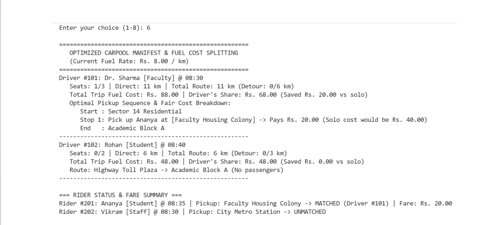
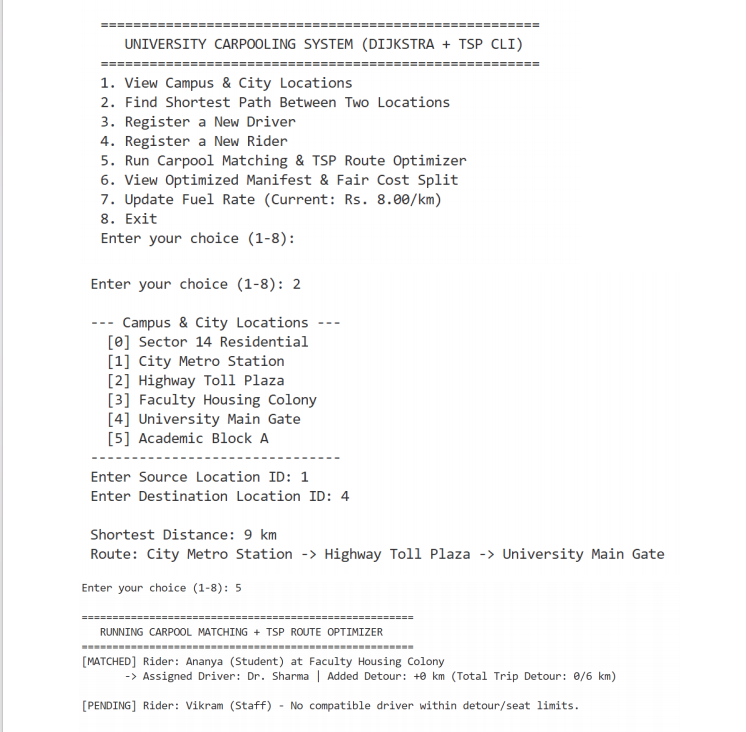

# University Campus Carpooling & Ride-Sharing Optimization System

<p align="center">
  <strong>Intelligent Ride Matching and Route Optimization Using Design & Analysis of Algorithms</strong>
</p>

<p align="center">
  
  
  
  
</p>

---

## 1. Project Overview

The **University Campus Carpooling & Ride-Sharing Optimization System** is a C++ application developed to optimize daily transportation for university students, faculty members, and administrative staff.

The system addresses common commuting problems such as individual fuel expenses, inefficient pickup routes, traffic congestion, and underutilized vehicle capacity.

It models the university road network as a weighted undirected graph and integrates graph algorithms, greedy optimization, and combinatorial search to perform shortest-path calculations, intelligent driver-rider matching, optimal pickup sequencing, and proportional fuel cost distribution.

## 2. Problem Statement

University commuters often travel along similar routes but use separate vehicles due to the absence of an efficient ride-sharing mechanism.

Manual carpooling arrangements can result in:

- Inefficient driver and passenger coordination.
- Unnecessary pickup detours.
- Unoptimized multi-passenger pickup sequences.
- Lack of departure-time and seating-capacity validation.
- Unfair fuel cost distribution.

This project provides an algorithm-driven solution to these challenges.

## 3. Key Features

- Weighted graph representation of campus and surrounding locations.
- Shortest-path calculation using Dijkstra's Algorithm.
- Constraint-based driver and rider matching.
- Greedy marginal detour optimization.
- Optimal multi-stop pickup sequencing using TSP.
- Vehicle seating-capacity validation.
- Destination and departure-time compatibility checks.
- Maximum detour constraints.
- Segment-by-segment proportional fuel cost splitting.
- Interactive menu-driven command-line interface.
- Input validation and optimized carpool manifest generation.

## 4. Algorithms & DAA Concepts

| Algorithm / Concept | Application |
|---|---|
| Weighted Undirected Graph | Represents campus locations and road distances. |
| Adjacency List | Stores connections between locations. |
| Dijkstra's Algorithm | Finds shortest routes between locations. |
| Min-Heap Priority Queue | Efficiently selects the minimum-distance vertex. |
| Greedy Algorithm | Selects the feasible driver with minimum marginal detour. |
| Travelling Salesperson Problem (TSP) | Optimizes the pickup sequence of multiple riders. |
| `std::next_permutation` | Evaluates possible pickup orders. |
| Proportional Cost Allocation | Distributes fuel expenses according to shared route segments. |

### Complexity Analysis

| Algorithm | Time Complexity |
|---|---|
| Graph Representation | O(V + E) space |
| Dijkstra's Algorithm | O((V + E) log V) |
| TSP Pickup Optimization | O(k! × k) |
| Greedy Driver-Rider Matching with TSP | O(R × D × k! × k) |
| Fuel Cost Splitting | O(k) |

**Notation:**
- V = Number of vertices.
- E = Number of edges.
- R = Number of riders.
- D = Number of drivers.
- k = Number of pickup locations/passengers considered.

## 5. System Workflow

1. Initialize the university campus road network.
2. Register drivers and riders.
3. Calculate shortest distances between locations.
4. Identify eligible drivers based on destination, available seats, and departure time.
5. Calculate optimal multi-stop pickup sequences.
6. Assign riders to drivers based on minimum marginal detour.
7. Calculate individual fuel contributions.
8. Generate the optimized carpool manifest.

## 6. Technology Stack

| Component | Technology |
|---|---|
| Programming Language | C++ |
| Standard | C++11 / C++17 |
| IDE | Visual Studio Code |
| Data Structures | Graph, Vector, Pair, Priority Queue |
| Libraries | C++ Standard Template Library (STL) |
| Interface | Command-Line Interface (CLI) |

## 7. Project Structure

```text
University-Carpooling-System/
│
├── car_pooling.cpp
├── README.md
├── .gitignore
│
└── screenshots/
    ├── project-demo.png
    └── project-demoq.png
```

## 8. Screenshots

### Project Demonstration



### Additional Output



## 9. Installation & Execution

### Prerequisites

- GCC / MinGW C++ compiler.
- Visual Studio Code (recommended).

### Clone the Repository

```bash
git clone https://github.com/Shobhit0524/University-Carpooling-System.git
```

### Navigate to the Project

```bash
cd University-Carpooling-System
```

### Compile the Application

```bash
g++ -std=c++17 car_pooling.cpp -o carpool
```

### Run the Application

**Windows:**

```bash
.\carpool.exe
```

**Linux / macOS:**

```bash
./carpool
```

## 10. Experimental Results

The project was evaluated using a representative six-location university transportation network.

The test scenario included two drivers, two riders, and a fuel rate of ₹8 per kilometer.

| Evaluation Metric | Result |
|---|---:|
| Total Solo Travel Distance | 27 km |
| Shared Travel Distance | 15 km |
| Total Solo Fuel Cost | ₹216 |
| Shared Fuel Cost | ₹120 |
| Total Fuel Savings | ₹96 |
| Vehicle Distance Reduction | 12 km |
| Overall Cost Savings | 44.4% |

*These results are from the representative experimental scenario documented in the academic project report.*

## 11. Future Enhancements

- Integration of a graphical user interface.
- Database integration for persistent driver and rider information.
- Real-time traffic and location updates.
- University ID-based user authentication.
- Global ride matching using Hungarian Algorithm or Min-Cost Max-Flow.
- All-Pairs Shortest Path optimization.

## 12. Academic Information

**Project:** University Campus Carpooling & Ride-Sharing Optimization System

**Subject:** Design & Analysis of Algorithms (5.0CE100COIH)

**Semester:** 5th Semester

**Academic Year:** 2026–2027

**Department:** Computer Science and Engineering

**Institution:** Manav Rachna International Institute of Research and Studies

## 13. Contributors

- Teena
- Sahil
- Shobhit
- Lucky

## 14. References

1. Cormen et al. — Introduction to Algorithms, 4th Edition.
2. Kleinberg and Tardos — Algorithm Design.
3. Dijkstra, E. W. (1959) — A Note on Two Problems in Connexion with Graphs.
4. Agatz et al. (2012) — Optimization for Dynamic Ride-Sharing: A Review.
5. Stroustrup — The C++ Programming Language, 4th Edition.

---

<p align="center">
  <strong>University Campus Carpooling System</strong>
  <br/>
  Optimizing Routes • Connecting Commuters • Reducing Travel Costs
</p>